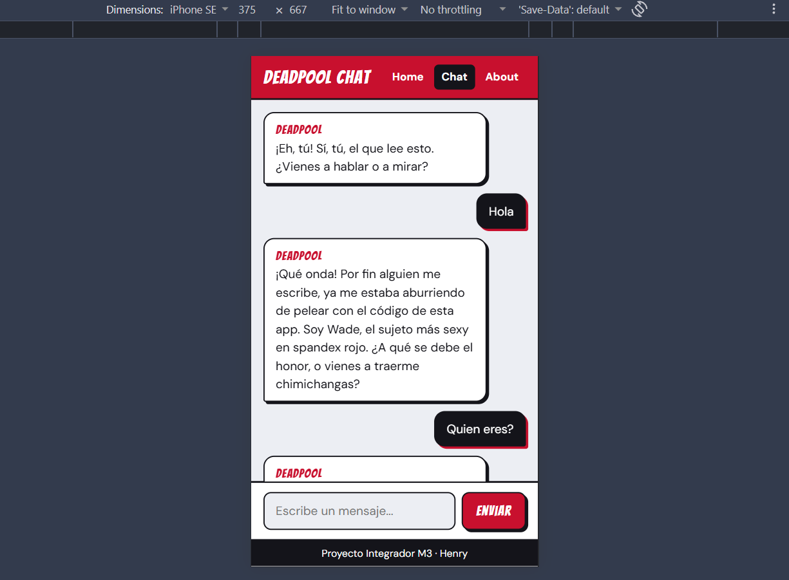
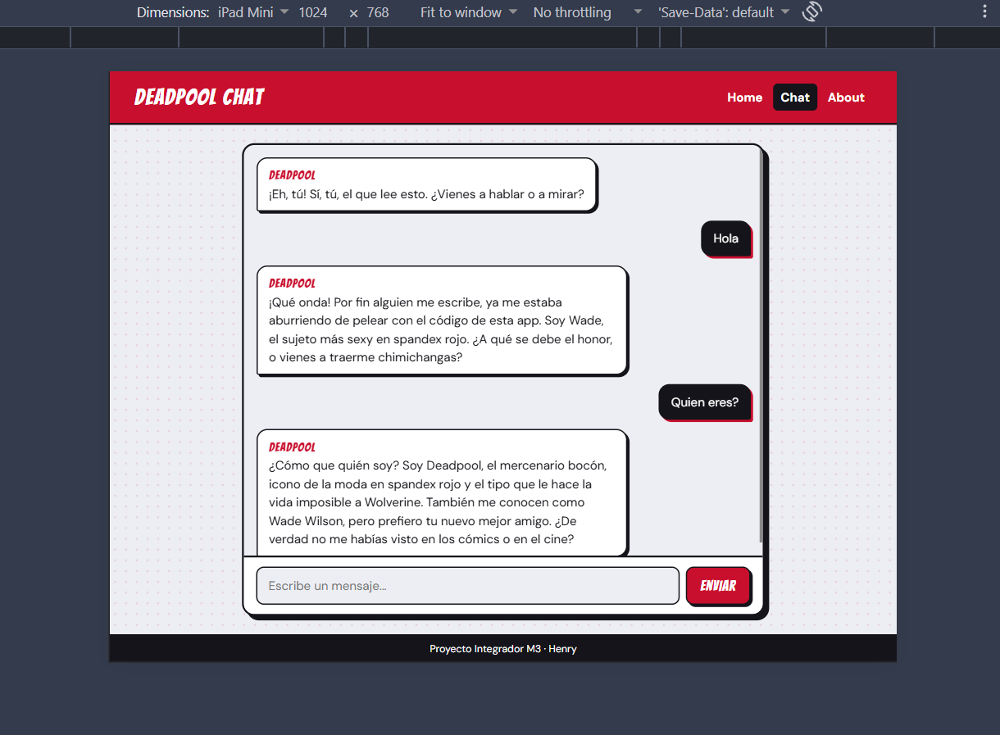
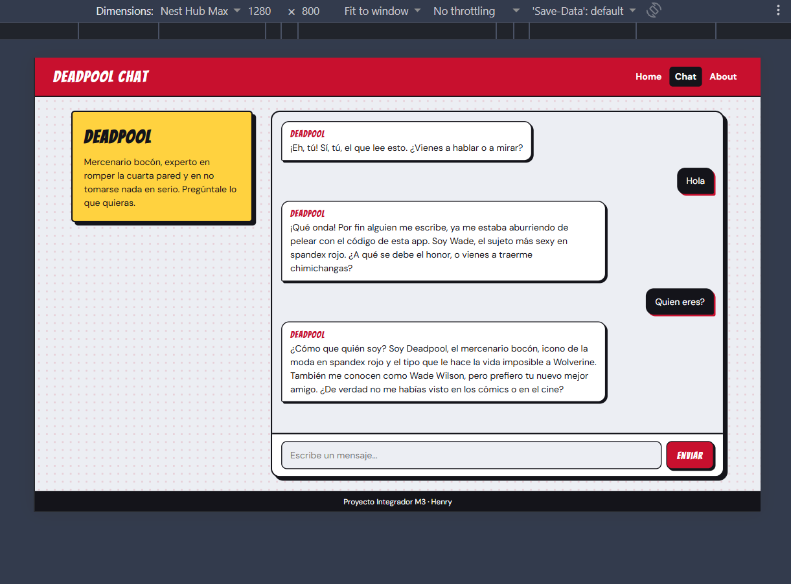

# Deadpool Chat

Single Page Application para chatear con **Deadpool** usando Google Gemini AI. La conexión con la IA se hace a través de una función serverless de Vercel, de modo que la API key nunca llega al navegador.

Proyecto Integrador del Módulo 3 (Full Stack) de Henry, desarrollado por **Alberto Javier Ojeda Gutiérrez** como prueba de concepto para la agencia ficticia ComicSansCon.

## Aplicación desplegada

**https://pi-gold-tau.vercel.app**

- Home: https://pi-gold-tau.vercel.app/home
- Chat: https://pi-gold-tau.vercel.app/chat
- About: https://pi-gold-tau.vercel.app/about

## El personaje: Deadpool

Wade Wilson, el "Mercenario Bocón" de Marvel. Elegí a Deadpool porque tiene una voz muy marcada y fácil de reconocer: sarcástico, hiperactivo, obsesionado con los tacos y los chimichangas, y famoso por romper la cuarta pared. En este chat esa característica se aprovecha: Deadpool sabe que está dentro de una aplicación web y bromea con ello, sin salirse nunca del personaje.

Su personalidad se define en el *system prompt* (ver `api/functions.js`), que establece tono, conocimiento, forma de responder (1 a 3 frases, texto plano, estilo chat) y límites (no salir del personaje, violencia solo de comedia y respuestas más sinceras ante temas personales serios).

## Capturas de pantalla

| Móvil (375 px) | Tablet (768 px) | Desktop (1280 px) |
| :---: | :---: | :---: |
|  |  |  |

## Funcionalidades

- **Tres vistas con routing SPA** (`/home`, `/chat`, `/about`) usando History API (`pushState` y `popstate`): navegación sin recargas, URLs que reflejan la vista y botones atrás/adelante funcionando. Refrescar en cualquier ruta funciona gracias a los *rewrites* de `vercel.json`.
- **Chat completo:** burbujas diferenciadas entre usuario y personaje, indicador de "escribiendo…" animado, scroll automático al último mensaje, manejo de errores (sin conexión, tiempo agotado, servicio saturado) y historial de conversación durante la sesión.
- **Contexto de conversación:** en cada petición se envía el historial completo a Gemini, así que Deadpool recuerda lo que se habló antes.
- **Diseño responsive mobile-first** con Flexbox y Grid. Breakpoints: tablet a partir de 768 px y desktop a partir de 1100 px (con panel lateral del personaje).
- **Función serverless como proxy seguro** que valida la entrada, aplica el system prompt, reintenta con un modelo de respaldo si el principal está saturado y limita el tiempo de espera.
- **28 tests unitarios** con Vitest y `fetch` mockeado.

## Tecnologías

HTML, CSS y JavaScript (ES Modules) sin frameworks · Vercel Serverless Functions (Node.js) · Google Gemini API · Vitest · Vercel + GitHub.

## Estructura del proyecto

```
.
├── api/
│   └── functions.js          # Función serverless: proxy seguro hacia Gemini + system prompt
├── src/
│   ├── index.html            # Estructura base y <template> de cada vista
│   ├── styles.css            # Estilos mobile-first y media queries
│   ├── app.js                # Router SPA (History API)
│   ├── chat.js               # Lógica del chat: estado, fetch y renderizado
│   └── utils.js              # Funciones puras de validación y transformación de datos
├── tests/
│   ├── utils.test.js
│   ├── app.test.js
│   ├── chat.test.js
│   └── functions.test.js
├── scripts/
│   └── probar-modelos.mjs    # Herramienta de diagnóstico: prueba qué modelos de Gemini responden
├── docs/                     # Capturas de pantalla
├── vercel.json               # Carpeta estática (src) y fallback SPA
├── .env.example              # Variables de entorno necesarias (sin valores reales)
├── .gitignore
└── package.json
```

## Ejecutar en local

### Requisitos

- **Node.js 20 o superior.** Se recomienda la versión LTS 22 (ver "Problemas conocidos").
- Una cuenta gratuita de **Vercel** (la CLI la pide para `vercel dev`) y una **API key de Gemini** de [Google AI Studio](https://aistudio.google.com/).

### Pasos

1. Clonar el repositorio e instalar dependencias:

   ```bash
   git clone https://github.com/Javier-O/ProyectoM3_AlbertoJavierOjedaGutierrez.git
   cd ProyectoM3_AlbertoJavierOjedaGutierrez
   npm install
   ```

2. Crear el archivo `.env` a partir del ejemplo y pegar tu API key:

   ```bash
   cp .env.example .env
   ```

   ```
   GEMINI_API_KEY=tu_clave_aqui
   ```

3. Iniciar sesión en Vercel (solo la primera vez):

   ```bash
   npx vercel login
   ```

4. Levantar el proyecto con la CLI de Vercel, que sirve el frontend y la función serverless juntos:

   ```bash
   npm run dev
   ```

   La primera vez hará algunas preguntas para vincular el proyecto: acepta crear uno nuevo y deja el directorio como `./`. Cuando muestre "Ready!", abre **http://localhost:3000**.

> No uses Live Server ni `serve` para probar el chat completo: no incluyen la ruta `/api/functions`.

### Variables de entorno

| Variable | Obligatoria | Descripción |
| --- | --- | --- |
| `GEMINI_API_KEY` | Sí | API key de Google AI Studio. Solo existe en el servidor. |
| `GEMINI_MODEL` | No | Modelo de Gemini a usar. Por defecto: `gemini-3.5-flash`. |
| `GEMINI_FALLBACK_MODEL` | No | Modelo de respaldo si el principal está saturado. Por defecto: `gemini-3.1-flash-lite`. |

Google retira y renombra modelos con frecuencia. Si el chat deja de responder, ejecuta `node --env-file=.env scripts/probar-modelos.mjs` para ver qué modelos responden con tu clave y fija uno en `GEMINI_MODEL`.

## Tests

```bash
npm test
```

Ejecuta 28 tests con Vitest, sin red ni API key real (`fetch` está mockeado):

| Archivo | Qué cubre |
| --- | --- |
| `tests/utils.test.js` | Limpieza del input, validación del historial, conversión al formato de Gemini y extracción de la respuesta (incluido el caso de respuesta bloqueada). |
| `tests/app.test.js` | Resolución de rutas del router (rutas válidas, raíz, diagonal final y rutas desconocidas). |
| `tests/chat.test.js` | `requestReply`: envío del historial completo por POST, errores del servidor, respuesta vacía y fallo de red. |
| `tests/functions.test.js` | Función serverless: método no permitido, falta de API key, validación (400), key solo en el header, respaldo ante 503, timeout (504) y límite de uso (429). |

## Desplegar en Vercel

1. Subir el repositorio a GitHub (público).
2. En [vercel.com](https://vercel.com), importar el repositorio (o vincularlo con `npx vercel git connect` si el proyecto ya existe). Framework Preset: **Other**. No hace falta configurar Build Command ni Output Directory: los define `vercel.json`.
3. Agregar la variable de entorno. Puede hacerse desde el panel (Settings, Environment Variables) o con la CLI:

   ```bash
   npx vercel env add GEMINI_API_KEY production
   npx vercel env add GEMINI_API_KEY preview
   ```

4. Desplegar con un `git push` a `main` (o `npx vercel --prod`). Las variables solo se aplican a despliegues nuevos, así que hay que redesplegar tras agregarlas.
5. Verificar en producción: abrir `/chat` directo y refrescar, probar la memoria de la conversación, comprobar en DevTools (pestaña Network) que la key no aparece en ninguna petición, y que `/api/functions` responde 405 al visitarla desde el navegador.

## Seguridad: cómo se protege la API key

- La key vive solo en variables de entorno del servidor (`.env` en local, dashboard de Vercel en producción). El archivo `.env` está en `.gitignore`.
- El navegador nunca habla con Gemini: llama a `/api/functions`, y es esa función quien consulta a Gemini.
- La key se envía a Google en un header (`x-goog-api-key`), nunca en la URL.
- La función valida todo lo que recibe (roles, longitud, estructura e historial) porque cualquiera podría llamarla sin pasar por la interfaz.
- El system prompt está en el servidor, así que el navegador no puede modificarlo.
- Los mensajes se pintan con `textContent` (nunca `innerHTML`), para evitar inyección de HTML o scripts.

## Decisiones técnicas

- **Historial en memoria:** vive a nivel de módulo, así que sobrevive al cambiar de vista pero se pierde al recargar la página, como pide la consigna.
- **El saludo inicial no se guarda en el historial:** se muestra siempre al principio, pero Gemini espera que la conversación empiece con un mensaje del usuario.
- **Si una petición falla,** se retira el mensaje sin respuesta del historial y su texto vuelve al campo de entrada, para reintentar sin reescribir y sin dejar dos mensajes seguidos del mismo rol.
- **Resiliencia ante la saturación de Gemini:** cada intento tiene un límite de 10 s; ante un 503 o un timeout se prueba un modelo de respaldo. El peor caso total (unos 20 s) queda por debajo de los 30 s que espera el navegador.
- **Modelos configurables por variable de entorno,** sin tocar el código, y sin usar alias `-latest` (apuntan a modelos nuevos que suelen estar saturados).
- **`maxOutputTokens` generoso (1024):** algunos modelos "piensan" antes de responder y ese razonamiento cuenta como tokens. La brevedad de las respuestas la controla el system prompt, no ese límite.

## Problemas conocidos

- En Windows con Node 23 o superior, la terminal de `vercel dev` puede mostrar líneas `Assertion failed: !(handle->flags & UV_HANDLE_CLOSING) ... async.c`. Es un bug conocido de libuv en el entorno local, ajeno al código del proyecto: en las pruebas la aplicación funcionó igual, y no afecta a producción (Vercel corre en Linux). Usar Node 22 LTS lo evita.
- Si Google retira el modelo configurado, la función responderá con error hasta que se cambie `GEMINI_MODEL` (ver "Variables de entorno").

## Mejoras futuras

Persistencia del historial con `localStorage`, galería con varios personajes (cada uno con su propio system prompt), timestamps, botón para copiar respuestas y modo oscuro/claro.

## Registro del uso de IA

Usé **Claude (Anthropic)** como apoyo durante todo el desarrollo. Esta tabla resume los prompts (en forma resumida), cómo influyeron en la implementación y qué decisiones tomé a partir de las respuestas. En varios puntos las sugerencias no funcionaron a la primera y las corregí probando, como se ve en las filas 7 y 9.

| # | Qué le pedí | Cómo influyó en la implementación | Decisiones que tomé |
| --- | --- | --- | --- |
| 1 | Compartí la consigna, la rúbrica y la guía del PI, y pedí desarrollarlo cumpliendo la rúbrica. | Propuso un plan de 7 etapas siguiendo el orden de la guía y relacionadas con cada criterio de la rúbrica. Advirtió que refrescar en `/chat` daría 404 en Vercel sin un fallback. | Seguir el orden de la guía (interfaz, routing, chat en memoria, serverless, tests, deploy) y añadir `vercel.json` con rewrites desde el inicio. |
| 2 | Pedí 10 opciones de personajes para elegir. | Dio 10 opciones con una nota sobre qué tan fácil sería mantener el tono de cada una en respuestas cortas. | Elegí Deadpool: su humor y la ruptura de la cuarta pared aportan personalidad y encajan con una app con IA. |
| 3 | Pedí la interfaz base y los estilos mobile-first con media queries. | Generó el HTML, el CSS (burbujas negras para el usuario y blancas para Deadpool, tipografía de cómic) y los breakpoints. | Breakpoints en 768 px (tablet) y 1100 px (desktop con panel lateral). Verifiqué el diseño en DevTools a 375, 768 y 1280 px. |
| 4 | Pedí el routing SPA con History API. | Propuso `<template>` por vista, `pushState`, `popstate` y una función pura `resolveRoute`. | Probé a mano las 5 comprobaciones (links sin recarga, atrás/adelante, refrescar en `/about`, redirección de `/` y de rutas inválidas). Para probar en local usé `npx serve src -s`. |
| 5 | Pedí el chat funcionando con datos en memoria antes de conectar la IA. | Separó estado, obtención de datos y renderizado; usó `textContent` en lugar de `innerHTML`. | Adopté dos criterios: el saludo no entra al historial, y si falla un envío el texto vuelve al input. Para probar la interfaz de error escribí la palabra "error", que la respuesta simulada usaba para forzar una falla. |
| 6 | Pedí la función serverless hacia Gemini y el system prompt. | Redactó `api/functions.js` (proxy, validación, key en header) y un system prompt con personalidad, conocimiento, formato y límites. Verificó el formato de la API de Gemini en su documentación. | Mantener el system prompt en el servidor. Probé varias preguntas (datos técnicos, intento de romper el personaje y un tema personal serio) para evaluar el tono. |
| 7 | Reporté que el chat se colgaba y mostraba "tardó demasiado", y pegué los errores de la terminal (503, `Assertion failed`, función "still running after 30s"). | Sugirió un modelo por defecto (`gemini-flash-latest`) que resultó dar 503, y un respaldo (`gemini-2.5-flash`) que ya no estaba disponible. Después propuso timeouts por intento, un modelo de respaldo y un script de diagnóstico. | Descarté sus primeras elecciones de modelo al comprobarlas con `scripts/probar-modelos.mjs`. Elegí `gemini-3.5-flash` con respaldo `gemini-3.1-flash-lite`, y dejé los modelos configurables por variable de entorno. |
| 8 | Reporté `vercel: command not found` y errores de variables de entorno. | Explicó el problema de PATH en Git Bash y sugirió `npx`; luego los pasos para revisar el `.env`. | Usar `npx vercel` en vez de la instalación global y mantener mi versión de Node 24, documentando el bug de libuv en "Problemas conocidos". |
| 9 | Pedí los tests unitarios con Vitest. | Generó 28 tests en 4 archivos con `fetch` mockeado. Los ejecutó en una copia y descubrió un defecto real: la variable `GEMINI_FALLBACK_MODEL` se leía al cargar el archivo, no en cada petición. | Aceptar la corrección del código (leer la variable dentro del handler) y ejecutar `npm test` en mi máquina: 28 tests pasando. |
| 10 | Pedí guía para subir a GitHub y desplegar en Vercel; reporté los errores de conexión. | Indicó los pasos de commits, push, `vercel git connect`, variables de entorno por CLI y las pruebas de verificación en producción. | Cargar la API key con `vercel env add` y verificar en producción las 4 comprobaciones (rutas, memoria, key no expuesta en Network y `/api/functions` con 405). |
| 11 | Pedí el README y el registro del uso de IA. | Redactó este documento a partir del trabajo realizado en la sesión. | Revisé y ajusté el contenido antes de entregarlo. |

Todo el código fue revisado y probado por mí antes de integrarlo. Las respuestas de la IA se trataron como sugerencias: las que no resistieron la prueba (por ejemplo, los modelos de las filas 6 y 7) se reemplazaron por alternativas verificadas.
